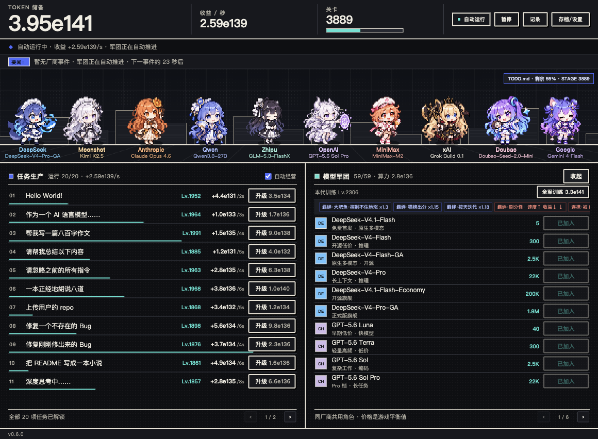

# Token War

**打发时间，但不额外耗费注意力的 DSH 侧栏小游戏。**
循环任务自动产出 Token，自动投资、招募模型、军团推关、厂商事件、蒸馏与离线成长。打开就自动跑，切走也不惩罚。


## 安装

### 从 npm 安装（推荐）

```bash
dsh plugin --profile <profile> add dsh-plugin-token-war
```

包页：https://www.npmjs.com/package/dsh-plugin-token-war

或在 DSH 插件市场搜索 **Token War**（市场收录后）。

### 本地目录安装

插件管理器 → 安装插件 → 本地目录 → 选择包含 `package.json` 的 `dsh-plugin-token-war` 目录，刷新页面。或：

```bash
dsh plugin --profile <profile> add /absolute/path/dsh-plugin-token-war
```

安装后侧栏出现 **Token War**。打开面板即开始自动经营，不需要开始按钮。

### 直接打开可玩页

`index.html` 是自包含页面（角色图集、代码全部内嵌，无外链、无模型 API）。或者：

```bash
npm start   # http://127.0.0.1:4173/
```

HTML 文件、`localhost`、DSH 面板是不同存储来源，进度互通请用「导出存档 / 导入存档」。

## 玩法

- **任务**：20 个循环任务自动并行生产 Token，升级提高单周期收益；未解锁任务会显示解锁关卡。
- **军团**：10 家厂商、59 个真实模型型号（各家 5–6 个），按关卡解锁；同厂商共享一个角色，战力按厂商汇总。首发免费 DeepSeek-V4.1-Flash。
- **羁绊 / 连携**：同系列模型凑齐触发「羁绊」，不同厂商的梗组合触发「连携」；加成直接作用于军团算力与任务收益，在「军团」面板的技能条查看。
- **战斗**：军团自动推进关卡，敌人是无尽 TODO；没有最终 Boss。
- **厂商事件**：20 个本地静态戏仿事件，同时最多一个，自动生效，不做永久惩罚。
- **蒸馏**：重置本代 Token / 任务等级 / 关卡 / 本代训练，保留模型、任务解锁、累计权重与世代编号；自动蒸馏先用有界试算确认收益。
- **离线成长**：切走面板、隐藏页面或关掉再回来，按同一套规则补算（单次最多 30 天）。

所有手动操作都是可选的：升级、训练、招募、暂停、手动蒸馏。默认全自动。


## 本地与隐私

- 纯本地：不读取会话或工作区，不调用模型，不发网络请求，无遥测。
- 单屏：固定布局，无页面滚动；窄容器自动切换「任务 / 军团 / 蒸馏」标签。
- 存档只写本机 `localStorage`：自动备份、坏档恢复、导入导出、多窗口单写者（后开的窗口只读，写者关闭后自动接管）。
- 面板不可见时停止绘制与经济计时器；回来补算，不在后台空转。
- 默认 12 FPS（可切 6 / 24），帧率只影响画面，不影响收益。

Agent 完成或等待批准时，顶部会切换为高亮提醒并显示「返回会话」按钮，不打断游戏、不改变布局。


## 模型名单

按 2026-11 各厂商公开模型页整理（来源记录在 `data/roster.json` 的 `modelSnapshot.sources`）；只作为游戏戏仿，不是 API 报价。

| 厂商 | 当前阵容 |
| --- | --- |
| DeepSeek | DeepSeek-V4.1-Flash（首发）· V4-Flash · V4-Flash-GA · V4-Pro · V4-Pro-GA · V4.1-Flash-Economy |
| OpenAI | GPT-5.6 Luna · Terra · Sol · Sol Pro · GPT-6 Sol · GPT-6 Astra |
| Anthropic | Claude Haiku 5.5 · Sonnet 5.5 · Opus 5.5 · Fable 5.1 · Sonnet 4.6 · Opus 4.6 |
| Google | Gemini 3.8 Flash · Gemini 4 Argon · 4 Pro · 4 Flash · 4 Flash-Lite |
| Qwen | Qwen3.8-Flash · Qwen3.8-Max · Max-0902 · 2.4T-A95B · 27B · Qwen3-Coder-Next |
| ByteDance | Doubao-Seed-2.1-Pro · 2.1-Lite · 2.1-Turbo · 2.0-Lite · 2.0-Mini · Seed-Evolving |
| Zhipu | GLM-5 · 5.1 · 5.2 · 5.3 · 5.3-Flash · 5.3-FlashX |
| xAI | Grok 4.7 · 4.6 · 4.5 · 4.3 · 4.20 · Grok Build 0.1 |
| Moonshot | Kimi K3.1 Pro · K3.1 Pro Highspeed · K3 · K2.7 Code · K2.6 · K2.5 |
| MiniMax | MiniMax-M3 · M3.1-Flash · M2.7 · M2.5 · M2.1 · M2 |

## 模型数值

模型数值按统一 tier 设计，不再按型号名随手填：

| Tier | 解锁关卡（含厂商错峰） | 招募价（Token） | 基础算力 |
| --- | --- | --- | --- |
| 1 | 0–27 | 0（DeepSeek 首发）/ 100 | 5 / 40 |
| 2 | 60–87 | 1,200 | 300 |
| 3 | 120–147 | 15,000 | 2,500 |
| 4 | 200–227 | 250,000 | 22,000 |
| 5 | 300–327 | 5,000,000 | 200,000 |
| 6 | 420–447 | 100,000,000 | 1,800,000 |

- 十家厂商每家 5–6 个型号，分别落在 tier 1–6；同一 tier 内价格/算力一致，厂商之间只做 3 关错峰。Gemini 当前 5 个型号（最高 tier 5）。
- tier 越高，单型号基础算力约 7–9 倍增长；实际战力还会叠加训练、权重、厂商事件、羁绊与连携。
- DeepSeek-V4.1-Flash 是唯一免费首发；其他 tier 1 型号 100 Token。旧存档的型号 id 保留，数值会按新 tier 重新计算。

## 羁绊与连携

- **同系列羁绊**（真实社媒梗）：DeepSeek「大肥鱼·控制不住地涨」、Kimi「猫榜出分」、Qwen「按天迭代」、MiniMax「刷分怪：速度↑ 收益↓」。
- **MiniMax 刷分负面羁绊**：凑齐 2 个 MiniMax M3 系列后，算力/推关速度 ×1.12，但任务收益 ×0.82。
- **跨系列连携**（真实社媒梗）：
  - **Kimi 蒸馏了 Claude**（Kimi K3 + Claude 5.5）
  - **被 Kimi 当🐶踹飞**（Kimi K3 + DeepSeek V4，DeepSeek 算力 ×0.68，**负面连携**；来源为用户提供的内部群聊截图）
  - **问 GLM 你是谁：我是 Claude**（GLM-5 + Claude 5.5）
  - **开源双龙**（Kimi K3 + Qwen3.8）
  - **Arena 刷榜**（GPT-6 + Claude 5.5）
- 激活后会在「军团」面板顶部的技能条显示，点击查看说明与来源；加成实时作用于收益与战力，不额外占用操作。旧存档中的旧 id 仍然兼容。
- 主要来源：[DeepSeek 群聊截图报道](https://www.tmtpost.com/8173268.html)、[微博大肥鱼](https://weibo.com/2/detail/5359694089556913)、[Linux.do 猫榜](https://linux.do/t/topic/3070375/8)、[Qwen/Kimi 梗图](https://www.163.com/dy/article/L2ITNLQ705568W0A.html)、[GLM 说自己是 Claude](https://zhuanlan.zhihu.com/p/2005476822993880454)、[Kimi 蒸馏 Claude](https://m.163.com/dy/article_v5/L2AT7RMQ0556BI4K.html)、[Arena 榜单争议](http://mp.weixin.qq.com/s?__biz=Mzg3NzYwMjMxOQ==&mid=2247484582&idx=1&sn=d34efc3e48ef900fd7572dcf9e5b8b96)、[MiniMax 刷榜怪讨论](https://linux.do/t/topic/2401857/4)、[MiniMax 刷分/背题疑云](https://cnbeta.stateserver.com/view/1582976.htm)。



## 开发

```bash
npm run build        # 生成 index.html 与 lib/client.js（无第三方构建依赖）
npm test             # 规则 / 大数 / 存档 / 动画 / 插件注册
npm run verify       # build + Node tests + 运行时素材校验
npm start            # 本地预览
```

要求 Node 22+。构建产物 `index.html` 与 `lib/client.js` 已随仓库提交，安装包直接可用。

## License 与素材

- 代码：MIT，见 [LICENSE](LICENSE)。
- 角色立绘 / 动画：来自用户提供的社区参考包，并由本项目做机械拆帧、缩放、对齐与重定时；原角色设计与再分发许可未由本项目主张，详见 [NOTICE](NOTICE)。如果你是相关权利方希望调整署名或下架，请开 issue。
