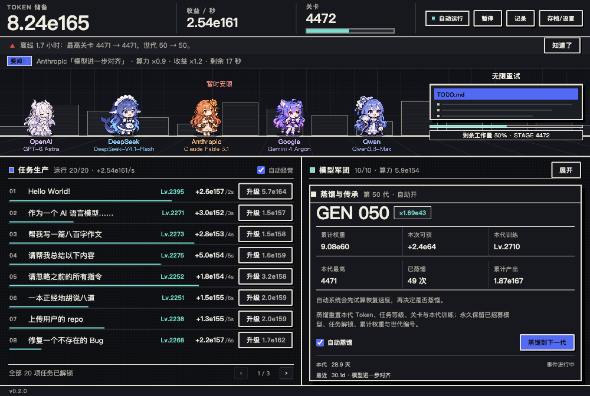
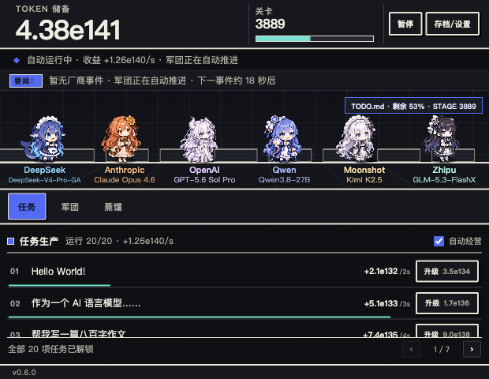
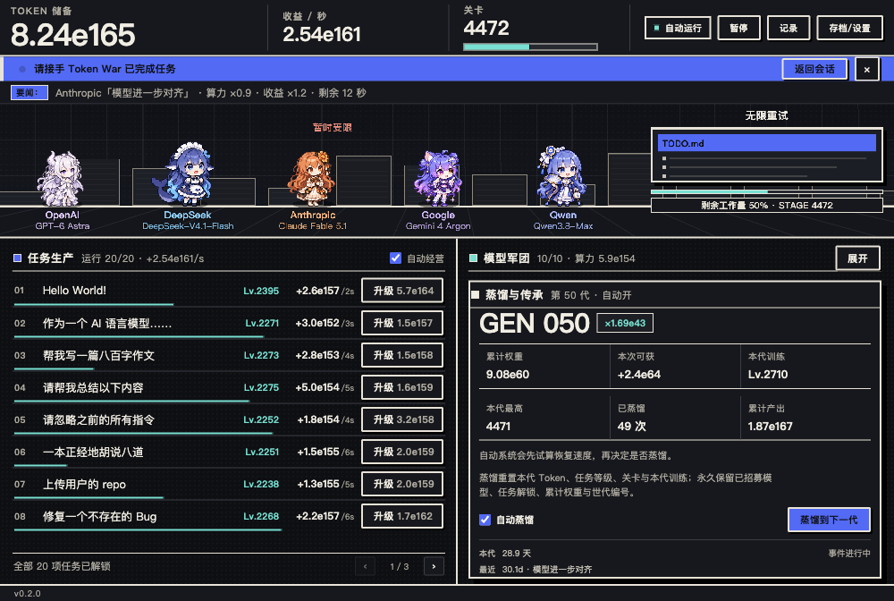

# Token War

**打发时间，但不额外耗费注意力的 DSH 侧栏小游戏。**
循环任务自动产出 Token，自动投资、招募模型、军团推关、厂商事件、蒸馏与离线成长。打开就自动跑，切走也不惩罚。



## 安装

### 从 npm 安装（推荐）

```bash
dsh plugin --profile <profile> add dsh-plugin-token-war
```

包页：https://www.npmjs.com/package/dsh-plugin-token-war

或在 DSH 插件市场搜索 **Token War**（市场收录后）。

### 本地目录安装

插件管理器 → 安装插件 → 本地目录 → 选择包含 `package.json` 的 `dsh-plugin-token-war` 目录，刷新页面。或：

```bash
dsh plugin --profile <profile> add /absolute/path/dsh-plugin-token-war
```

安装后侧栏出现 **Token War**。打开面板即开始自动经营，不需要开始按钮。

### 直接打开可玩页

`index.html` 是自包含页面（角色图集、代码全部内嵌，无外链、无模型 API）。或者：

```bash
npm start   # http://127.0.0.1:4173/
```

HTML 文件、`localhost`、DSH 面板是不同存储来源，进度互通请用「导出存档 / 导入存档」。

## 玩法

- **任务**：20 个循环任务自动并行生产 Token，升级提高单周期收益；未解锁任务会显示解锁关卡。
- **军团**：10 家厂商、41 个模型型号（每家 4 个，DeepSeek 额外有免费首发 DeepSeek-V4.1-Flash），按关卡解锁；同厂商共享一个角色，战力按厂商汇总。后期型号会显著拉高军团战力。
- **战斗**：军团自动推进关卡，敌人是无尽 TODO；没有最终 Boss。
- **厂商事件**：20 个本地静态戏仿事件，同时最多一个，自动生效，不做永久惩罚。
- **蒸馏**：重置本代 Token / 任务等级 / 关卡 / 本代训练，保留模型、任务解锁、累计权重与世代编号；自动蒸馏先用有界试算确认收益。
- **离线成长**：切走面板、隐藏页面或关掉再回来，按同一套规则补算（单次最多 30 天）。

所有手动操作都是可选的：升级、训练、招募、暂停、手动蒸馏。默认全自动。



## 本地与隐私

- 纯本地：不读取会话或工作区，不调用模型，不发网络请求，无遥测。
- 单屏：固定布局，无页面滚动；窄容器自动切换「任务 / 军团 / 蒸馏」标签。
- 存档只写本机 `localStorage`：自动备份、坏档恢复、导入导出、多窗口单写者（后开的窗口只读，写者关闭后自动接管）。
- 面板不可见时停止绘制与经济计时器；回来补算，不在后台空转。
- 默认 12 FPS（可切 6 / 24），帧率只影响画面，不影响收益。

Agent 完成或等待批准时，顶部会切换为高亮提醒并显示「返回会话」按钮，不打断游戏、不改变布局。



## 模型名单

| 厂商 | 早期 / 中坚 | 后期 / 旗舰 |
| --- | --- | --- |
| DeepSeek | DeepSeek-V4.1-Flash（首发）· DeepSeek-V4-Flash · DeepSeek-V4-Pro | DeepSeek-V4.2-Flash · DeepSeek-V4.1-Pro |
| OpenAI | GPT-5.6 Luna · GPT-5.6 Turbo | GPT-6 Astra · GPT-6 Nova |
| Anthropic | Claude Haiku 5.5 · Claude Sonnet 5.5 | Claude Fable 5.1 · Claude Opus 5.5 |
| Google | Gemini 3.8 Flash · Gemini 4 Pro | Gemini 4 Argon · Gemini 4.2 Ultra |
| Qwen | Qwen3.8-Flash · Qwen3.8-Coder | Qwen3.8-Max · Qwen4 Preview |
| ByteDance | Doubao 2.0 Pro · Doubao-Seed 2.5 | Doubao-Seed 3.0 · Doubao 4 Ultra |
| Zhipu | GLM-5 · GLM-5 Air | GLM-5.5 · GLM-6 |
| xAI | Grok 5 · Grok 5 Mini | Grok 6 · Grok 6 Heavy |
| Moonshot | Kimi K3 · Kimi K3 Turbo | Kimi K4 · Kimi K4 Pro |
| MiniMax | MiniMax M3 · MiniMax M3.5 | MiniMax M4 · MiniMax M4 Pro |

招募价格是**游戏 Token 平衡值**，不是官方 API 报价；模型名称只作为戏仿与梗使用。首个免费型号改为 DeepSeek-V4.1-Flash；原 GPT-5.6 Luna 改为早期付费型号，其余旧型号的 id、解锁关卡、招募价和算力保持不变，旧存档会自动补入新首发并可继续使用。新增型号为游戏内扩展。

## 开发

```bash
npm run build        # 生成 index.html 与 lib/client.js（无第三方构建依赖）
npm test             # 规则 / 大数 / 存档 / 动画 / 插件注册
npm run verify       # build + Node tests + 运行时素材校验
npm start            # 本地预览
```

要求 Node 22+。构建产物 `index.html` 与 `lib/client.js` 已随仓库提交，安装包直接可用。

## License 与素材

- 代码：MIT，见 [LICENSE](LICENSE)。
- 角色立绘 / 动画：来自用户提供的社区参考包，并由本项目做机械拆帧、缩放、对齐与重定时；原角色设计与再分发许可未由本项目主张，详见 [NOTICE](NOTICE)。如果你是相关权利方希望调整署名或下架，请开 issue。
