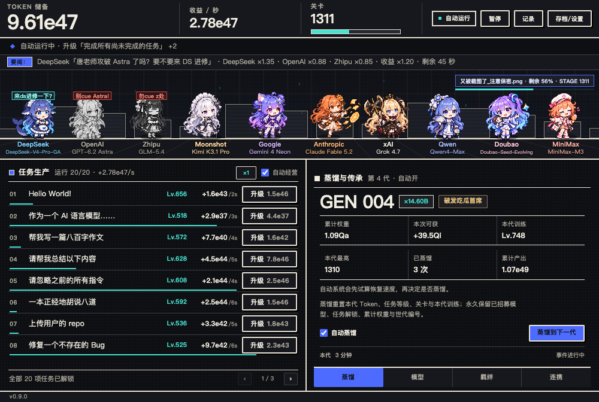
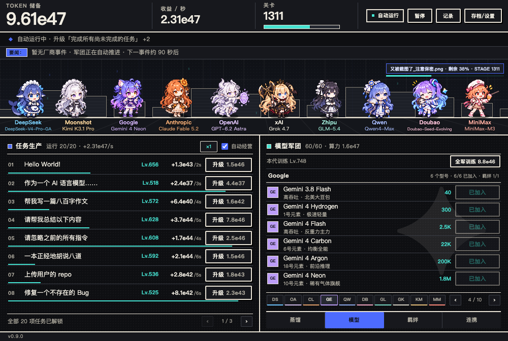
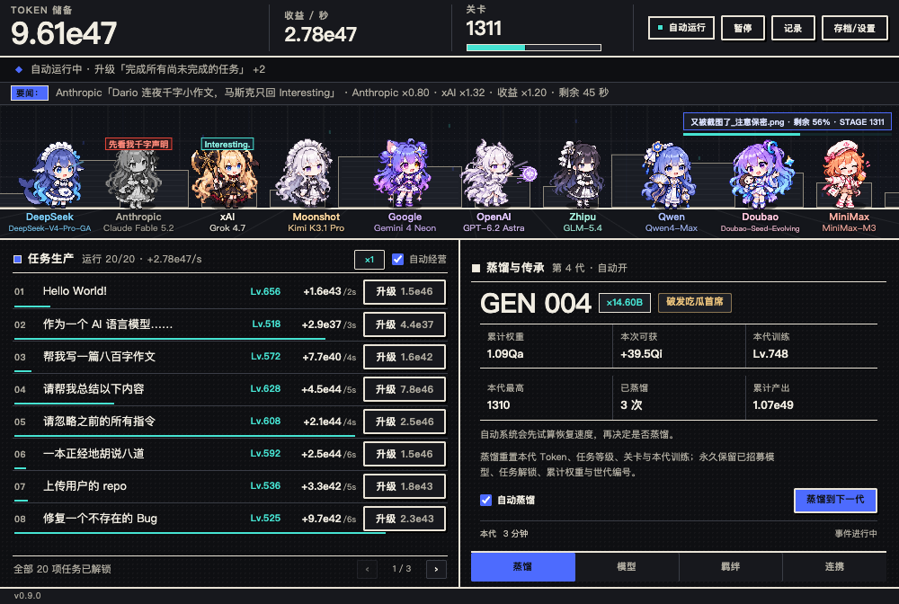
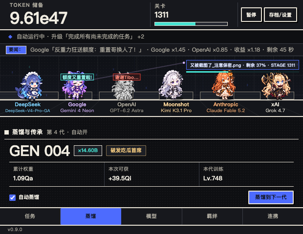
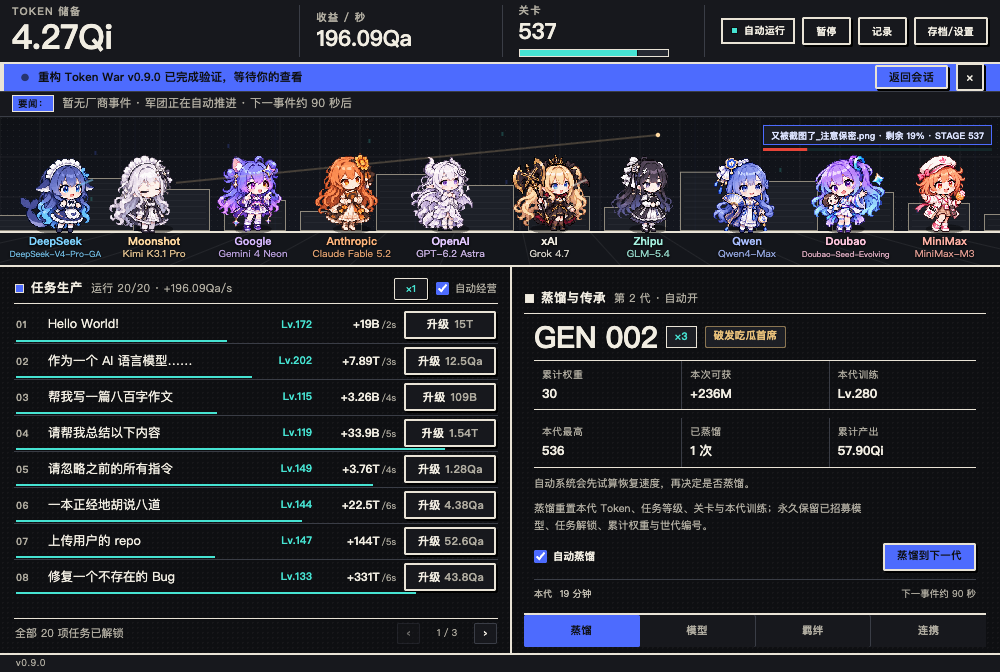
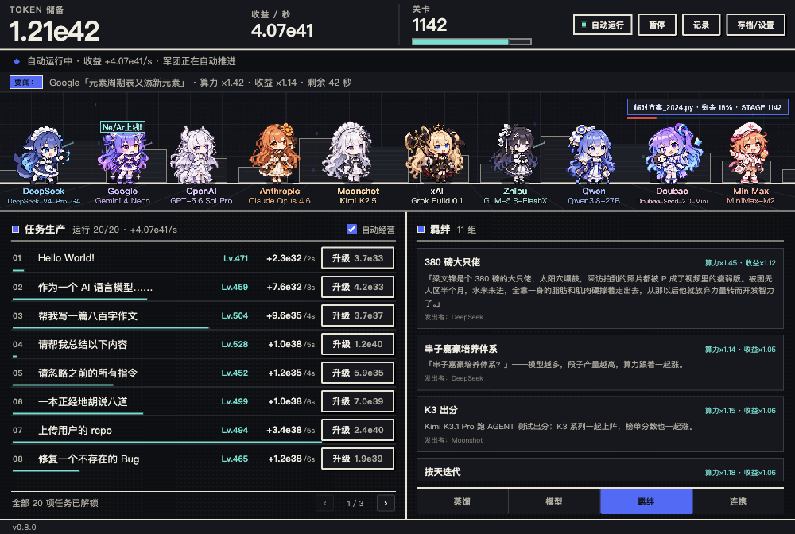
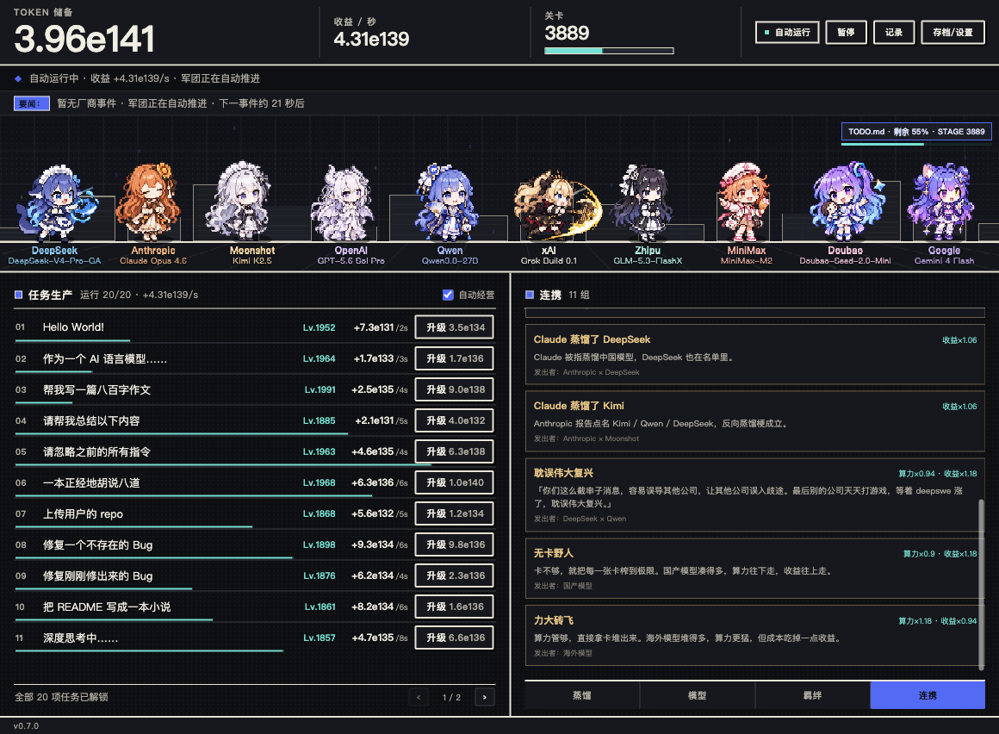

# Token War

**打发时间，但不额外耗费注意力的 DSH 侧栏小游戏。**
循环任务自动产出 Token，自动投资、招募模型、军团推关、厂商事件、蒸馏与离线成长。打开就自动跑，切走也不惩罚。



## 安装

### 从 npm 安装（推荐）

```bash
dsh plugin --profile <profile> add dsh-plugin-token-war
```

包页：https://www.npmjs.com/package/dsh-plugin-token-war

或在 DSH 插件市场搜索 **Token War**（市场收录后）。

### 本地目录安装

插件管理器 → 安装插件 → 本地目录 → 选择包含 `package.json` 的 `dsh-plugin-token-war` 目录，刷新页面。或：

```bash
dsh plugin --profile <profile> add /absolute/path/dsh-plugin-token-war
```

安装后侧栏出现 **Token War**。打开面板即开始自动经营，不需要开始按钮。

### 直接打开可玩页

`index.html` 是自包含页面（角色图集、代码全部内嵌，无外链、无模型 API）。或者：

```bash
npm start   # http://127.0.0.1:4173/
```

HTML 文件、`localhost`、DSH 面板是不同存储来源，进度互通请用「导出存档 / 导入存档」。

## 玩法

- **任务**：20 个循环任务自动并行生产 Token，升级提高单周期收益；未解锁任务会显示解锁关卡。
- **军团**：10 家厂商、60 个真实模型型号（每家完整 6 档），按关卡解锁；同厂商共享一个角色，战力按厂商汇总。首发免费 DeepSeek-V4.1-Flash。
- **羁绊 / 连携**：全部 10 家厂商均有专属「羁绊」（共 13 组），跨厂商与阵营组合触发「连携」（共 26 组）；加成直接作用于军团算力与任务收益，在侧栏的「羁绊」「连携」Tab 查看。
- **模型 Tab**：按厂商分页，顶部支持 10 家厂商快捷跳转，每页展示一家厂商的 6 档型号与已加入数量；同厂商共用一个角色。


- **战斗**：军团自动推进关卡，18 个关卡目标与 12 个每 10 关 Boss 按 AI/程序员梗名轮换；战场有呼吸浮动、攻击火花、飞向状态条的弹道和顶部工作量条，没有最终 Boss。
- 厂商遭遇事件时，角色头顶会弹出像素风短梗气泡（支持双厂隔空对线气泡）；受限角色自动变灰，窄屏自动将事件当事人置顶，事件结束后恢复。平时无事件时，战场角色也会随机冒出日常吐槽，点击角色可直接触发人设吐槽气泡（全 10 厂商 60 句热梗，含 12 句 DeepSeek 员工群串子语录）。
- **事件池 53 个**（纯本地静态戏仿，同时最多一个）：覆盖全部 10 家厂商与全网行业大事件，含「我一直是达里奥粉丝」「唐老师攻破 Astra 了吗？要不要来 DS 进修」「重置哥换人了：谢谢反重力」「Dario 连夜千字小作文，马斯克只回 Interesting」「普天同庆：Anthropic 破发！」「最近在工位玩游戏的太多了」「黄仁勋皮衣发布会」等；抽屉内置「事件图鉴」记录已见证事件。


- **蒸馏**：重置本代 Token / 任务等级 / 关卡 / 本代训练，保留模型、任务解锁、已见证事件图鉴、累计权重与世代编号，并可在 15 个梗头衔中点击切换当前展示头衔；自动蒸馏先用有界试算确认收益。
- **离线成长**：切走面板、隐藏页面或关掉再回来，按同一套规则补算（单次最多 30 天）。

所有手动操作都是可选的：升级、训练（均支持 `×1 / ×10 / MAX`）、招募、暂停、手动蒸馏。默认全自动，顶部通知行会实时显示最近一次自动动作。



## 本地与隐私

- 纯本地：不读取会话或工作区，不调用模型，不发网络请求，无遥测。
- 单屏：固定布局，无页面滚动；右侧栏底部为「蒸馏 / 模型 / 羁绊 / 连携」Tab，默认打开蒸馏；窄屏同样使用底部 Tab（额外保留「任务」）。
- 存档只写本机 `localStorage`：自动备份、坏档恢复、导入导出、多窗口单写者（后开的窗口只读，写者关闭后自动接管）。
- 面板不可见时停止绘制与经济计时器；回来补算，不在后台空转。
- 默认 12 FPS（可切 6 / 24），帧率只影响画面，不影响收益。

Agent 完成或等待批准时，顶部会切换为高亮提醒并显示「返回会话」按钮，不打断游戏、不改变布局。



## 模型名单

按 2026-11-28 各厂商公开模型页整理（来源记录在 `data/roster.json` 的 `modelSnapshot.sources`）；只作为游戏戏仿，不是 API 报价。

| 厂商 | 当前阵容（Tier 1 → Tier 6） |
| --- | --- |
| DeepSeek | DeepSeek-V4.1-Flash（首发）· DeepSeek-V4-Flash · DeepSeek-V4-Flash-GA · DeepSeek-V4-Pro · DeepSeek-V4.1-Flash-Economy · DeepSeek-V4-Pro-GA |
| OpenAI | GPT-6 Luna · GPT-6.1 Terra · GPT-6.1 Sol · GPT-6 Astra · GPT-6.2 Sol · GPT-6.2 Astra |
| Anthropic | Claude Haiku 5.5 · Claude Sonnet 4.6 · Claude Sonnet 5.5 · Claude Opus 4.6 · Claude Opus 5.5 · Claude Fable 5.2 |
| Google | Gemini 3.8 Flash · Gemini 4 Hydrogen · Gemini 4 Flash · Gemini 4 Carbon · Gemini 4 Argon · Gemini 4 Neon |
| Qwen | Qwen3.8-Flash · Qwen3.8-27B · Qwen3-Coder-Next · Qwen3.8-Max · Qwen3.8-2.4T-A95B · Qwen4-Max |
| ByteDance | Doubao-Seed-2.0-Mini · Doubao-Seed-2.0-Lite · Doubao-Seed-2.1-Lite · Doubao-Seed-2.1-Turbo · Doubao-Seed-2.1-Pro · Doubao-Seed-Evolving |
| Zhipu | GLM-5 · GLM-5.1 · GLM-5.2 · GLM-5.3-Flash · GLM-5.3 · GLM-5.4 |
| xAI | Grok 4.3 · Grok 4.5 · Grok 4.6 · Grok 4.20 · Grok Build 0.1 · Grok 4.7 |
| Moonshot | Kimi K2.5 · Kimi K2.6 · Kimi K2.7 Code · Kimi K3 · Kimi K3.1 Pro Prime · Kimi K3.1 Pro |
| MiniMax | MiniMax-M2 · MiniMax-M2.1 · MiniMax-M2.5 · MiniMax-M2.7 · MiniMax-M3.1-Flash · MiniMax-M3 |

## 模型数值

模型数值按统一 tier 设计，不再按型号名随手填：

| Tier | 解锁关卡（含厂商错峰） | 招募价（Token） | 基础算力 |
| --- | --- | --- | --- |
| 1 | 0–27 | 0（DeepSeek 首发）/ 100 | 5 / 40 |
| 2 | 60–87 | 1,200 | 300 |
| 3 | 120–147 | 15,000 | 2,500 |
| 4 | 200–227 | 250,000 | 22,000 |
| 5 | 300–327 | 5,000,000 | 200,000 |
| 6 | 420–447 | 100,000,000 | 1,800,000 |

- 十家厂商每家满 6 个型号（共 60 个），分别落在 tier 1–6；同一 tier 内价格/算力一致，厂商之间只做 3 关错峰。
- tier 越高，单型号基础算力约 7–9 倍增长；实际战力还会叠加训练、权重、厂商事件、羁绊与连携。
- DeepSeek-V4.1-Flash 是唯一免费首发；其他 tier 1 型号 100 Token。旧存档的型号 id 保留，数值会按新 tier 重新计算。

## 羁绊与连携

- **同系列羁绊**（13 组，覆盖全部 10 家厂商）：DeepSeek「380 磅大只佬」「串子嘉豪培养体系」「梁文锋的企业精神」「注意保密 · 又被截图了」、Claude「a畜的自我修养」、智谱「z畜祖传手艺」、Google「元素周期表集邮」、OpenAI「In the coming weeks」、豆包「厘时代价格战」、Grok「Colossus 十万卡」、Kimi「K3 出分」、Qwen「按天迭代」、MiniMax「刷分怪：速度↑ 收益↓」。
- **MiniMax 刷分负面羁绊**：凑齐 2 个 MiniMax M3 系列后，算力/推关速度 ×1.12，但任务收益 ×0.82。
- **跨系列与阵营连携**（26 组）：
  - **普天同庆：Anthropic 破发**（Claude + DeepSeek + GPT-6：Claude ×0.85、友商加攻、全网收益 ×1.18）
  - **a畜 × z畜：双向奔赴**（Claude + GLM-5：Claude ×0.92、GLM ×1.15、收益 ×1.12）
  - **我一直是达里奥粉丝**（DeepSeek V4 + Claude 5：DeepSeek ×1.06、Claude ×1.05、收益 ×1.06）
  - **「不如k3.1」：首先我不是串子**（DeepSeek V4 + Kimi K3：DeepSeek ×0.95、Kimi ×1.10、收益 ×1.07）
  - **唐老师攻破 Astra 了吗？来 DS 进修**（DeepSeek V4 + GPT-6 + GLM-5：DeepSeek ×1.10、OpenAI ×0.95、Zhipu ×0.93、收益 ×1.08）
  - **重置哥换人了：谢谢反重力**（GPT-6 + Gemini 4：OpenAI ×0.93、Google ×1.12、收益 ×1.07）
  - **北美大豆包 × 正宗大豆包**（Gemini 4 + Doubao Seed 2.1：算力 ×0.97、收益 ×1.12）
  - **雷霆大思考 × 12h 吞光额度**（GLM-5 + Kimi K3：算力 ×1.12、收益 ×0.94）
  - **千字小作文 vs Interesting**（Claude 5 + Grok 4：Claude ×0.95、Grok ×1.12、收益 ×1.07）
  - **证得了黎曼猜想，画不出 13 个鸡蛋**（Claude 5 + Gemini 4 + GPT-6：算力 ×1.08、收益 ×0.96）
  - **Kimi 蒸馏了 Claude**（Kimi K3 + Claude 5.5）
  - **被 Kimi 当🐶踹飞**（Kimi K3 + DeepSeek V4，DeepSeek 算力 ×0.68，**负面连携**）
  - **问 GLM 你是谁：我是 Claude**（GLM-5 + Claude 5.5）
  - **开源双龙**（Kimi K3 + Qwen3.8）
  - **Arena 刷榜**（GPT-6 + Claude 5.5）
  - **马斯克 vs 奥特曼**（Grok 4 + GPT-6）
  - **视频生成内卷**（Doubao Seed 2.1 + MiniMax M3）
  - **价格战打到厘**（DeepSeek + Doubao + Qwen）
  - **全员 Flash 白嫖团**（Gemini 4 + DeepSeek + Qwen）
  - **元素炼丹：稀有气体 × 长文本**（Gemini 4 + Kimi K3）
  - **耽误伟大复兴**（DeepSeek V4 + Qwen3.8，算力 ×0.94、收益 ×1.18）
  - **无卡野人**（国产模型满 10 个，算力 ×0.90、收益 ×1.18）
  - **力大砖飞**（海外模型满 8 个，算力 ×1.18、收益 ×0.94）
  - **Claude 蒸馏了 Qwen / DeepSeek / Kimi**（三组，收益 ×1.06）
- 激活后会分别在「羁绊」「连携」Tab 显示，卡片标明这个技能发出自哪家厂商；加成实时作用于收益与战力，不额外占用操作。旧存档中的旧 id 仍然兼容。
- 主要来源：[DeepSeek 群聊截图报道](https://www.tmtpost.com/8173268.html)、[微博大肥鱼](https://weibo.com/2/detail/5359694089556913)、[Linux.do ](https://linux.do/t/topic/3070375/8)、[Qwen/Kimi 梗图](https://www.163.com/dy/article/L2ITNLQ705568W0A.html)、[GLM 说自己是 Claude](https://zhuanlan.zhihu.com/p/2005476822993880454)、[Kimi 蒸馏 Claude](https://m.163.com/dy/article_v5/L2AT7RMQ0556BI4K.html)、[Arena 榜单争议](http://mp.weixin.qq.com/s?__biz=Mzg3NzYwMjMxOQ==&mid=2247484582&idx=1&sn=d34efc3e48ef900fd7572dcf9e5b8b96)、[Claude 蒸馏中国模型报道](https://www.c114.net.cn/industry/85669.html)、[蒸馏回旋镖](https://www.bianews.com/news/details?id=238954&type=0)、[MiniMax 刷榜怪讨论](https://linux.do/t/topic/2401857/4)、[MiniMax 刷分/背题疑云](https://cnbeta.stateserver.com/view/1582976.htm)、[员工群串子截图合集（B站，47 万播放）](https://www.bilibili.com/video/BV1jvn46dE2R/)。





## 开发

```bash
npm run build        # 生成 index.html 与 lib/client.js（无第三方构建依赖）
npm test             # 规则 / 大数 / 存档 / 动画 / 插件注册
npm run verify       # build + Node tests + 运行时素材校验
npm start            # 本地预览
```

要求 Node 22+。构建产物 `index.html` 与 `lib/client.js` 已随仓库提交，安装包直接可用。

## License 与素材

- 代码：MIT，见 [LICENSE](LICENSE)。
- 角色立绘 / 动画：来自用户提供的社区参考包，并由本项目做机械拆帧、缩放、对齐与重定时；原角色设计与再分发许可未由本项目主张，详见 [NOTICE](NOTICE)。如果你是相关权利方希望调整署名或下架，请开 issue。
